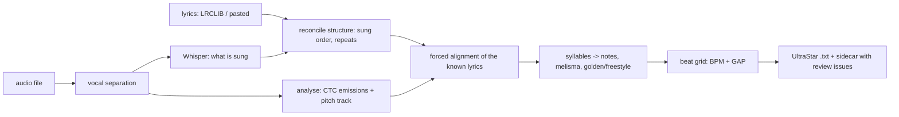
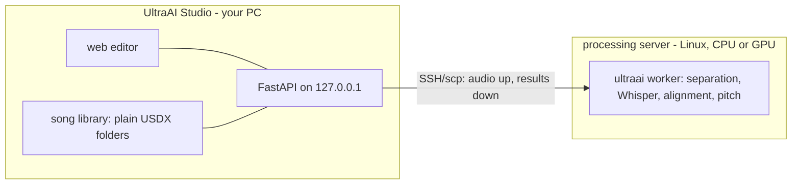

# UltraAI

Turns songs into [UltraStar Deluxe](https://usdx.eu) karaoke files automatically: lyrics,
timing, line breaks and notes. Lyrics come from a sidecar file, LRCLIB, the audio file's own
tags, or — as a flagged last resort — YouTube captions; numerals are spelled out (`22` →
`twenty-two`) so they align with the sung words. The lyrics are treated as the truth; the
audio decides *when* each syllable is sung and at which pitch. A risk model plus pitch
double-checks mark the places where the machine is unsure, and **UltraAI Studio** takes you
straight there to fix them.

Long-form guides live in [docs/guides/](docs/guides/README.md).

Inspired by [UltraSinger](https://github.com/rakuri255/UltraSinger) — but written from
scratch, not a fork; [PLAN.md](PLAN.md) §1 lists what reading its code taught us.

## How it works



Every expensive step is cached per audio file in `~/.cache/ultraai/work/<hash>/`, so changing
lyrics or re-running costs seconds. Generated songs are scored against hand-made ones
(`ultraai eval`, `scripts/`), which is how every heuristic here was tuned — see
[BENCHMARK.md](BENCHMARK.md) for the measurements.

Recent additions: robust beat grid (BPM/GAP scored against detected onsets), `#VIDEOGAP` when a
video file sits next to the audio, `#PREVIEWSTART` at the chorus, optional `.lrc`/`.ass`
exports, song-level "lyrics may not match the singing" warning, RMVPE pitch double-check
warnings (on by default), validator warnings (overlaps, missing breaks, …) shown as issues at
the exact song time with a jump-to button, editor version history with one-click restore, live
song-list updates (server-sent events), parallel worker jobs (`ULTRAAI_MAX_JOBS`), and
YouTube rate-limit handling (`ULTRAAI_COOKIES` + browser impersonation). See the
[docs/guides/](docs/guides/README.md) for details.



## UltraAI Studio (Windows app)

Download the installer from the [latest release](https://github.com/Sternpaul/UltraAI/releases/latest)
and run it (per-user install, no admin rights; Windows may warn about an unknown publisher:
*More info → Run anyway*).

1. **Settings** → choose the song library folder and enter the SSH host of the processing
   server (`user@server`, same as you log in with). **Test connection**.
   The connection is non-interactive: use a key without passphrase or load it into
   Windows' ssh-agent (`ssh-add`).
2. **Add songs**: paste a YouTube link, use *Add files…*, or drop audio files on the window.
   Processing runs on the server (about 10 minutes per new song); the song list shows
   each step with an ETA – click *steps* for details.
   Before processing, a small window asks how: vocal separation model (HTDemucs, HTDemucs
   fine-tuned, MelBand RoFormer), pitch model (SwiftF0, PESTO, CREPE tiny/full), any number of
   extra separation and pitch models as a **double check** (where they disagree becomes an
   issue), optional removal of backing vocals, and the note style (*like the singer*,
   *easier*: only clear pitch changes become extra notes, *easiest*: one note per syllable).
   *Use these as my defaults* remembers the choice. The window estimates the time; a server
   with a CUDA GPU runs all model steps much faster (install a CUDA build of PyTorch there).
3. **Review**: songs marked *Needs review* open in the editor at the first uncertain spot.
4. Songs without lyrics online get *Add lyrics* (prefilled with what speech recognition heard).

The library is a normal USDX song folder (`Artist - Title/Artist - Title.txt`, `.m4a`/`.ogg`,
`[VD].mp4`, `[CO].jpg`; the YouTube link is kept as `#AUDIOURL`/`#VIDEOURL`) – point UltraStar Deluxe at it.

### Editor in one minute

* Top: preview as the game shows it. Middle: notes over the singer's pitch curve (orange),
  with what speech recognition heard (grey words) and the vocal waveform. Red areas are
  places to check; the list on the right explains why. `Tab` jumps to the next one.
* The issue list also checks live, while you edit: words of the lyrics missing in the song
  (red ▲), words that are not in the lyrics (red dashed notes), notes that do not match the
  voice, flat notes where the voice moves, and unusual jumps (often backing vocals or noise).
* Drag notes in time/pitch, drag their edges, drag the ▼ line-break markers. `N` adds a note.
* Double-click a note to change its syllable (`Tab` = next note); `Enter` edits the whole line
  (`|` separates syllables: `Re|lease my bo|dy`).
* *★ Golden notes…* re-places golden notes (hard jumps, big held notes, highest notes, mix).
* *USDB* shows the txt ready for usdb.animux.de: the `#VIDEO` meta tags — `v=<YouTube id>` for audio/video and `co=<url>` (the video's thumbnail) for the cover — are the links USDB Syncer fetches the media from.
* `T` (tap mode): the line plays, hold any letter key for each syllable – fastest way to
  re-time a line. `P` sets selected notes to the sung pitch.
* `Space` play, `L` loop, `V` vocals only, `[` `]` speed, `Ctrl+Z` undo, `?` all shortcuts.
* Everything saves automatically (the song list updates live, no refresh needed); every save
  is kept in `.studio/versions/` — *Versions* on a song card lists them and restores any of
  them with one click.
* Save warnings (e.g. overlapping notes) stay visible as a toast with a **Show** button and
  appear in the issue list at the exact time in the song; `Tab` or the ⇥ button jumps there.

### Settings worth knowing

| Setting | Default | |
|---|---|---|
| YouTube audio | Best available | Usually Opus, stored as `.ogg` without re-encoding |
| Music video | Up to 1080p | H.264 where possible; set as `#VIDEO` |
| Cover | on | Video thumbnail as `#COVER` |
| Vocal separation | Standard | ~5 min/song; "cleaner vocals" takes 20–30 min |
| Log detail | Normal | *Everything* logs every request, SSH command and download message |
| YouTube cookies | off | Path to a `cookies.txt` (browser export) — lifts YouTube 429 rate limits on downloads/captions. The file is a secret: only its path is used, never logged or uploaded |

Logs: the *Log* page in the app, or `%APPDATA%\UltraAI\studio.log`.

## Processing server

Linux with Python ≥ 3.11 and ffmpeg (CPU is enough; a GPU makes it ~10× faster):

```bash
git clone https://github.com/Sternpaul/UltraAI.git && cd UltraAI
python3 -m venv .venv && .venv/bin/pip install -e ".[worker]"
```

Or run the worker as a container — the image (linux/amd64 + linux/arm64, ffmpeg included)
is published per release tag:

```bash
docker pull ghcr.io/sternpaul/ultraai-worker:v0.1.17   # image tag = release tag
docker run --rm \
  -v "$HOME/.cache/ultraai:/cache" \
  -v "$PWD:/work" -w /work \
  ghcr.io/sternpaul/ultraai-worker:v0.1.17 process JOBDIR
```

The image sets `ULTRAAI_CACHE=/cache` and declares `/cache` a volume, so mount the host
cache there to keep model downloads and per-song step caches between runs.

The Studio expects it in `~/UltraAI` (configurable). Jobs run one at a time in the
background (`systemd-run` in the `ultraai.slice` user slice when available), so closing the
Studio does not stop them. Optional CPU cap: `~/.config/systemd/user/ultraai.slice` with
`[Slice]` / `CPUQuota=320%`.

## Command line

```
ultraai process JOBDIR        process one job folder (what the Studio runs on the server)
ultraai studio [--no-window]  run the Studio (any OS; opens a browser without pywebview)
ultraai batch ...             convert a folder of audio files
ultraai eval ...              score against hand-made songs
ultraai check FILE.txt        validate an UltraStar file
```

## Development

* `ultraai/` – pipeline (`generate.py`, `align.py`, `structure.py`, `issues.py`, …),
  `worker.py`, `studio/` (backend + `web/` editor, plain ES modules, no build step).
* `pip install -e ".[worker,dev]" && pytest`
* `BENCHMARK.md` – which separation/pitch/karaoke models score best (and what is still being measured).
* `docs/pipeline-improvements.md` – researched ideas for the automatic pipeline, with measured verdicts.
* `docs/ROADMAP.md`, `docs/ultrastar-format.md` – roadmap; the USDX format we read/write.
* `PLAN.md` – method and measurements; `EDITOR_PLAN.md` – Studio design and status.
* Guides: [docs/guides/](docs/guides/README.md) (Studio, CLI, configuration reference, troubleshooting).
* All `ULTRAAI_*` settings are registered in `ultraai/config.py` (`python -c "from ultraai import config; print(config.table())"`).
* The Windows installer is built by `.github/workflows/windows-installer.yml`
  (PyInstaller + Inno Setup); tag `vX.Y.Z` to publish a release.
